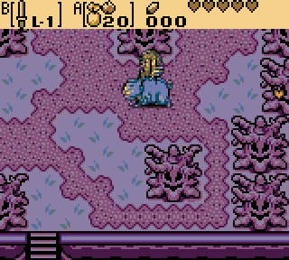
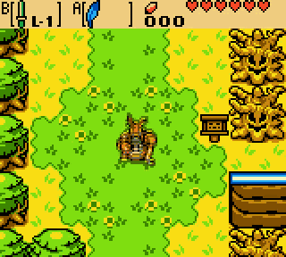
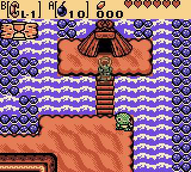
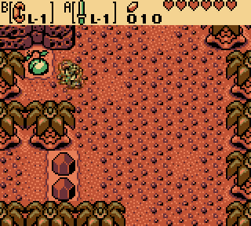

# vibeslop-oracle-bot

I was playing Oracle of Ages, and my Switch ran out of battery and lost my save file. Ordinarily, I'd put it down and never pick it back up. But it's 2026, we have AI now, and I figured... why not tell Claude to play the game?

The goal here was to get to the start of the third dungeon, which is pretty much exactly where I stopped. It worked. :)

| | |
|---|---|
|  |  |
|  |  |

The rest of the README, and the entirety of the code, is written by Claude.

## What it does

The bot starts a new game and plays to the entrance of the third dungeon, the Moonlit Grotto. That's about 81
minutes of game time. Along the way it:

- clears the first two dungeons, bosses included;
- picks up every heart piece you can reach before the third dungeon;
- trades along the trading sequence as far as it goes before then;
- saves the game before and after each dungeon.

Every run is the same, button press for button press. So the whole playthrough is stored as a small text file
of inputs, and anyone can replay it and check they get the same result.

## How to run it

You need your own copy of the game. It isn't included.

1. Install [uv](https://docs.astral.sh/uv/).
2. Put the US Oracle of Ages ROM at `roms/oracle_of_ages.gbc`.
3. Clone [oracles-disasm](https://github.com/Stewmath/oracles-disasm) into `vendor/oracles-disasm`, and check
   out the commit named in `tools/gen_symbols.py`.
4. Set up and generate the game data:

   ```
   uv sync
   uv run python tools/gen_symbols.py
   ```

5. Play:

   ```
   uv run obot run
   ```

It takes about 5 minutes. The saves land in `runs/main/checkpoints/`. Each folder has a `game.sav` for your
emulator.

To just check the stored playthrough without running the bot (about 1 minute):

```
uv run obot verify checkpoints/replay.log
```

## Your own names and choices

`config.toml` holds the things that should match your old save: your file name, the baby's name, how much you
gave the doctor, and so on. After changing one, run again. You only need to start from the step that uses it:

| Setting | Run |
|---|---|
| `child_name` | `uv run obot run --from name_child` |
| `donation` | `uv run obot run --from doctor_donation` |
| anything else | `uv run obot run` |

## Videos

Any part of a run can be turned into a video afterwards (needs ffmpeg). For example, the whole run at 32x with
the game time shown:

```
uv run obot video --from 0 --speed 32 --scale 4 --caption --max-seconds 0
```

## License

Apache 2.0. See [LICENSE](LICENSE). Not affiliated with Nintendo or Capcom.
